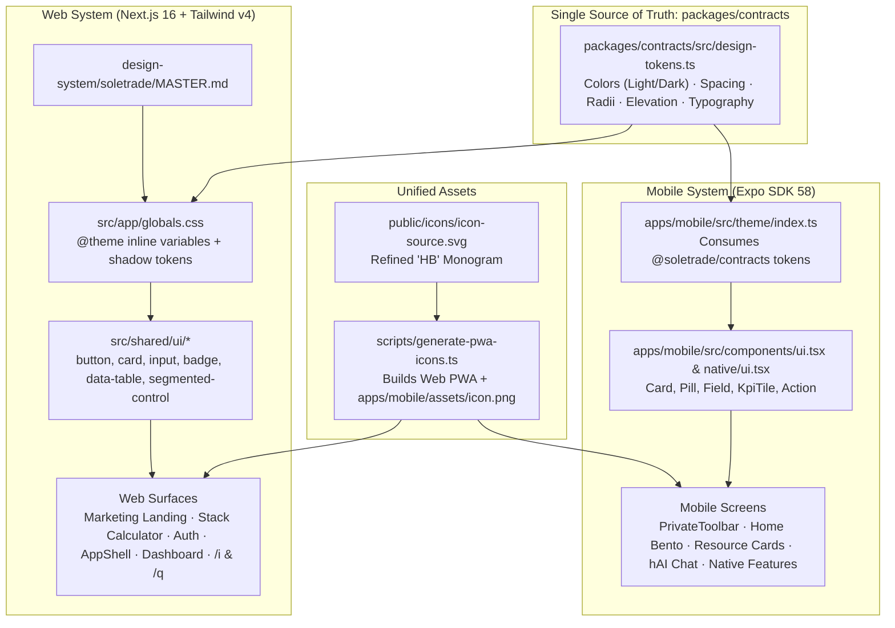

# Soletrade — World-Class Web & Mobile UI + Branding Refresh Plan ("Editorial Precision": Uber × Airbnb)

> **For downstream agentic workers:**
> - **Execution Mode:** Use `superpowers:subagent-driven-development` (recommended) or `superpowers:executing-plans` to implement this plan task-by-task.
> - **Goal:** Modernize both **Web** (Next.js 16 + Tailwind v4 + shadcn/ui) and **Mobile** (Expo SDK 58 + React Native + `@expo/ui`) into an **Uber × Airbnb ("Editorial Precision")** design language with high-contrast Obsidian Ink (`#141413`), deep Cobalt accent (`#1D4ED8`), warm alabaster canvas (`#F9F8F6`), continuous squircle radii, and unified tokens in `packages/contracts`.
> - **Scope Guardrails:** Maintain financial and domain precision (`JetBrains Mono tabular-nums` for all numerics/currency/distance), preserve merchant branding dominance on public pages (`/i/[token]` and `/q/[token]`), preserve all existing Jest and Maestro accessibility/testID contracts on mobile, and adhere to `pnpm branding:check`.

---

## 1. Executive Summary & Design System North Star

### 1.1 The Design Philosophy: "Editorial Precision" (Uber × Airbnb)

1. **Uber Base Design System (Operational Precision):**
   - **Obsidian Ink Authority:** Primary buttons, critical headers, and navigation states use deep obsidian (`#141413` light / `#F5F4F0` dark) rather than generic gray.
   - **Tactile Telemetry & Live Status:** Active shifts, mileage trackers, and invoice lifecycles use high-visibility status pills with semantic tints rather than full saturated fills or bare text.
   - **Display Numerals:** Financial figures, invoice totals, and KPI metrics strictly use `tabular-nums` in `JetBrains Mono` (web) and monospace/tabular figures (mobile) with bold weight and tight tracking.
2. **Airbnb Design Language System (Warm Editorial Hospitality):**
   - **Warm Alabaster Canvas:** `#F9F8F6` background (never sterile `#FFFFFF` or cold gray `#F8FAFC`).
   - **Layered Ambient Depth:** Multi-tiered subtle paper elevation (`--shadow-xs` resting card depth, `--shadow-md` interactive hover, `--shadow-xl` floating sheets/modals) rather than harsh 1px-only wireframes or heavy 90s drop shadows.
   - **Continuous Squircle Radii:** 10px controls (`rounded-lg`), 16px cards (`rounded-2xl` with iOS continuous curve), 22px hero containers (`rounded-3xl`), and 9999px pills.
   - **Deep Cobalt Accent:** Shifted from generic royal blue to refined Deep Cobalt (`#1D4ED8` light / `#3B82F6` dark) for interactive links, focus rings, and `hAI` assistant sparks.

---

## 2. Architecture & Token Foundation

### 2.1 Authoritative Token Table

| Semantic Token | Light Mode Hex | Dark Mode Hex | Usage / Role |
| :--- | :--- | :--- | :--- |
| `background` | `#F9F8F6` | `#0A0A09` | Warm alabaster canvas / obsidian dark canvas |
| `surface` / `card` | `#FFFFFF` | `#141413` | Pure elevated paper card |
| `surfaceSubtle` / `muted` | `#F2F0EC` | `#1E1D1B` | Bento metric tile, segmented track, table header |
| `foreground` / `text` | `#141413` | `#F5F4F0` | High-contrast obsidian ink |
| `mutedForeground` / `muted` | `#65625C` | `#A39E93` | Warm neutral secondary copy (contrast ≥ 4.8:1) |
| `primary` | `#141413` | `#F5F4F0` | Primary CTA pill / inverted ink pill in dark |
| `primaryForeground` | `#FFFFFF` | `#141413` | Text on primary CTA |
| `accent` / `brandBlue` | `#1D4ED8` | `#3B82F6` | **Deep Cobalt**: interactive links, focus rings, `hAI` spark |
| `accentTint` | `#EFF6FF` | `#172554` | Soft blue tint for active pills and selection |
| `border` / `line` | `#E6E4DF` | `#262522` | Crisp 1px architectural divider |
| `success` | `#059669` | `#34D399` | Semantic: Paid, Accepted, Positive delta, Active shift |
| `successTint` | `#ECFDF5` | `#064E3B` | Tinted background for Paid / Accepted pills |
| `warning` | `#D97706` | `#FBBF24` | Semantic: Due soon, Pending review, Queued draft |
| `warningTint` | `#FFFBEB` | `#451A03` | Tinted background for Warning pills |
| `destructive` | `#E11D48` | `#FB7185` | Semantic: Overdue, Void, Declined, Delete |
| `destructiveTint` | `#FFF1F2` | `#4C0519` | Tinted background for Destructive pills |

---

## 3. Implementation Blueprint (Task-by-Task for Executing Agent)

### Task 1: Establish Shared Design Tokens in Contracts & Unify Brand Assets

**Files:**
- `packages/contracts/src/design-tokens.ts` (NEW)
- `packages/contracts/src/index.ts` (MODIFY)
- `public/icons/icon-source.svg` (MODIFY)
- `public/icons/icon-maskable-source.svg` (MODIFY)
- `scripts/generate-pwa-icons.ts` (MODIFY)

**Steps:**
1. Create `packages/contracts/src/design-tokens.ts` exporting `designTokens` with the exact token table above (colors, spacing, radius scale `sm: 10, md: 16, lg: 22, pill: 999`, and typography specs).
2. Export `designTokens` from `packages/contracts/src/index.ts`.
3. Refine `public/icons/icon-source.svg` and `icon-maskable-source.svg` to feature the refined `HB` monogram on `#141413` with `#F9F8F6` `H` and `#1D4ED8`→`#3B82F6` `B`.
4. Update `scripts/generate-pwa-icons.ts` to also copy/render `apps/mobile/assets/icon.png` (1024×1024), so mobile and web icons are generated from one canonical vector source.
5. Run `pnpm icons:generate`.
6. Run `pnpm branding:check` to ensure brand guard passes.

---

### Task 2: Update Design System Master & Web Foundation Tokens

**Files:**
- `design-system/soletrade/MASTER.md` (MODIFY)
- `design-system/soletrade/pages/dashboard.md` (MODIFY)
- `design-system/soletrade/pages/public-invoice-quote.md` (MODIFY)
- `src/app/globals.css` (MODIFY)
- `src/shared/ui/button.tsx` (MODIFY)
- `src/shared/ui/card.tsx` (MODIFY)
- `src/shared/ui/input.tsx` (MODIFY)
- `src/shared/ui/badge.tsx` (MODIFY)
- `src/shared/ui/segmented-control.tsx` (MODIFY)
- `src/shared/ui/data-table.tsx` (MODIFY)

**Steps:**
1. In `MASTER.md`, replace the flat zero-shadow "Neutral Pro" mandate with "Editorial Precision (Uber × Airbnb)":
   - Permit 3-tier ambient paper elevation (`--shadow-xs`, `--shadow-md`, `--shadow-xl`).
   - Upgrade control heights from `h-9` (`36px`) to `h-10` (`40px`, touch `44px` on mobile).
   - Set radii to `rounded-lg` (controls), `rounded-2xl` (cards), `rounded-3xl` (hero/receipts), and `rounded-full` (pills).
2. In `src/app/globals.css`:
   - Wire `:root` and `.dark` variables to the new palette.
   - Set `--brand-blue: #1d4ed8` in light and `--brand-blue: #3b82f6` in dark.
   - Configure `--shadow-xs: 0 1px 2px rgba(20, 20, 19, 0.04), 0 0 0 1px var(--border)`.
   - Configure `--shadow-md: 0 8px 24px -4px rgba(20, 20, 19, 0.08), 0 2px 6px -1px rgba(20, 20, 19, 0.04)`.
   - Configure `--shadow-xl: 0 20px 40px -12px rgba(20, 20, 19, 0.16)`.
3. In `src/shared/ui/button.tsx`:
   - Set default height to `h-10 px-4 rounded-lg` with `active:scale-[0.99] transition-all`.
   - Set `lg` to `h-12 px-7 rounded-xl text-base font-semibold`.
4. In `src/shared/ui/card.tsx`:
   - Set base card classes to `rounded-2xl border border-border/80 bg-card shadow-xs`.
5. In `src/shared/ui/segmented-control.tsx`:
   - Modernize the control into an Airbnb-style pill slider (`rounded-xl bg-muted p-1` with `rounded-lg bg-card text-foreground shadow-xs` for the active item).
6. In `src/shared/ui/data-table.tsx`:
   - Wrap in `rounded-2xl border border-border bg-card shadow-xs overflow-x-auto`.
   - Clean up table header styling to `text-[11px] font-semibold uppercase tracking-wider text-muted-foreground/80 bg-muted/40`.
7. Run `pnpm test src/shared/ui` to verify all primitive tests stay green.

---

### Task 3: Modernize Web Marketing, Pricing, Auth, Shell & Public Pages

**Files:**
- `src/app/(marketing)/page.tsx` (MODIFY)
- `src/app/(marketing)/pricing/page.tsx` (MODIFY)
- `src/app/(marketing)/pricing/stack-calculator.tsx` (NEW)
- `src/app/(auth)/layout.tsx` (MODIFY)
- `src/app/(auth)/login/page.tsx` (MODIFY)
- `src/app/(auth)/signup/page.tsx` (MODIFY)
- `src/shared/components/app-shell/app-shell.tsx` (MODIFY)
- `src/app/(app)/dashboard/page.tsx` (MODIFY)
- `src/app/(app)/dashboard/kpi-card.tsx` (MODIFY)
- `src/app/i/[token]/page.tsx` (MODIFY)
- `src/app/q/[token]/page.tsx` (MODIFY)

**Steps:**
1. **Marketing Landing (`src/app/(marketing)/page.tsx`):**
   - Retain existing text/headings for test compatibility (`brand.productName`, `brand.tagline`, `brand.shortDescription`).
   - Add a subtle category pill above the hero (`Soletrade · Web & Native iOS/Android`).
   - Add an interactive workspace preview frame below the hero with live KPI cards and a shift preview.
   - Replace the 4 small boxes with a 2×2 Bento module showcase with workflow tags and pricing badges.
2. **Pricing (`src/app/(marketing)/pricing/page.tsx`):**
   - Create `stack-calculator.tsx`: a client component letting users toggle `Books`, `Quotes`, `Drive`, `Invoices` + `Monthly`/`Annual` to dynamically see their Anchor App and stack savings.
   - Retain the full 4×4 `Per-product prices` table underneath for existing tests.
3. **Auth Pages (`(auth)/layout.tsx`, `login/page.tsx`, `signup/page.tsx`):**
   - Upgrade container to `rounded-2xl border border-border bg-card p-8 sm:p-10 shadow-xs`.
   - Keep copyright lines and form IDs intact for `src/app/(auth)/*.test.tsx`.
4. **AppShell & Dashboard (`app-shell.tsx`, `dashboard/page.tsx`, `kpi-card.tsx`):**
   - Active sidebar item gets a tactile high-contrast pill indicator (`bg-foreground text-background shadow-xs`).
   - KPI cards get pill-styled delta badges (`rounded-full bg-success/10 text-success px-2 py-0.5`).
   - Mobile bottom bar gets frosted glass (`bg-background/90 backdrop-blur-md`).
5. **Public Invoices & Quotes (`i/[token]/page.tsx`, `q/[token]/page.tsx`):**
   - **Crucial Fix:** Remove hardcoded `bg-[#F8FAFC]`, `bg-white`, and `border-emerald-200 bg-emerald-50 text-emerald-800`.
   - Use `bg-background text-foreground`, `rounded-3xl border border-border bg-card p-6 sm:p-8 shadow-xs`.
   - Use `font-mono text-4xl font-semibold tracking-tight tabular-nums` for the hero amount.
   - Use `bg-success/10 border border-success/20 text-success` for paid/accepted confirmations.
6. Run `pnpm test src/app/(marketing) src/app/(auth)` to verify zero regression.

---

### Task 4: Modernize Mobile Theme, Primitives & Chrome (`apps/mobile`)

**Files:**
- `apps/mobile/src/theme/index.ts` (MODIFY)
- `apps/mobile/src/components/ui.tsx` (MODIFY)
- `apps/mobile/src/native/ui.tsx` (MODIFY)
- `apps/mobile/src/components/private-toolbar.tsx` (MODIFY)

**Steps:**
1. **Mobile Theme (`apps/mobile/src/theme/index.ts`):**
   - Import `designTokens` from `@soletrade/contracts`.
   - Replace the legacy navy slate palette (`#182B3A`, `#1766AF`) with `designTokens.colors`.
   - Expand `typography` to include `hero`, `metric` (`fontVariant: ["tabular-nums"]`), `title`, `headline`, `body`, `caption`, and `mono`.
2. **Mobile Primitives (`apps/mobile/src/components/ui.tsx`):**
   - **Important:** Keep `testID={title}` on buttons and preserve all component prop signatures for Jest suites in `apps/mobile/src/__tests__/`.
   - Upgrade `<Group>` to continuous squircle cards with `borderRadius: radius.md`, `borderColor: theme.line`, and `backgroundColor: theme.surface`.
   - Upgrade `<Field>` to modern boxed inputs with `borderRadius: radius.sm` and `backgroundColor: theme.surfaceSubtle`.
   - Add `<KpiTile>` / `<StatusPill>` helpers for Bento grids and status rendering.
   - Upgrade `<Choice>` to render scrollable horizontal filter pills when options count `<= 6`.
3. **Mobile Native Feature Primitives (`apps/mobile/src/native/ui.tsx`):**
   - Replace all hardcoded hex values (`#f7f5f0`, `#192b3c`, `#131b23`, `#8195a7`, `#142b40`, `#9f2424`) with `useTheme()` tokens from `@/theme`.
4. **Private Toolbar (`apps/mobile/src/components/private-toolbar.tsx`):**
   - Replace `<Text>H</Text>` with an obsidian `HB` vector monogram badge.
   - Render the workspace switcher as an Uber-style pill (`{workspaceName} ▾`).
   - Retain `testID="private-toolbar"` and all button text labels required by `global-actions.test.tsx`.
5. Run `pnpm --dir apps/mobile test src/__tests__/global-actions.test.tsx src/__tests__/ui-review.test.tsx`.

---

### Task 5: Modernize Mobile Screens & Workflows

**Files:**
- `apps/mobile/src/screens/tabs.tsx` (MODIFY)
- `apps/mobile/src/screens/resources.tsx` (MODIFY)
- `apps/mobile/src/screens/auth.tsx` (MODIFY)
- `apps/mobile/src/screens/assistant.tsx` (MODIFY)
- `apps/mobile/src/components/trends.tsx` (MODIFY)

**Steps:**
1. **Home & Tabs (`apps/mobile/src/screens/tabs.tsx`):**
   - In `HomeScreen`, render "At a glance" KPIs in a 2×2 Bento Grid (`KpiTile`) with large tabular figures (`typography.metric`).
   - Retain accessibility labels and `title`/`trailing` test contracts for `apps/mobile/src/__tests__/home-overview.test.tsx`.
   - In `SalesScreen`, `MoneyScreen`, `DriveScreen`, add hero quick-action banners ("Start or review shift", "Capture receipt").
   - In `MoreScreen`, add a workspace/account overview card above the settings rows.
2. **Resource Lists & Details (`apps/mobile/src/screens/resources.tsx`):**
   - Replace the single-string `entitySubtitle` with structured rows featuring a dedicated `<StatusPill>` (`Paid`, `Overdue`, `Sent`, `Draft`), clean secondary line, and right-aligned tabular currency amount.
3. **Auth (`apps/mobile/src/screens/auth.tsx`):**
   - Add the `HB` monogram + `Soletrade` branding header.
   - Make the primary CTA prominent (filled obsidian pill) and demote secondary toggles to clean text/ghost links.
4. **Assistant (`apps/mobile/src/screens/assistant.tsx`):**
   - Modernize the chat thread with distinct user (right-aligned tinted bubble) and `hAI` (left-aligned surface card with avatar badge) messages, plus starter prompt chips on empty threads.
5. **Trends Chart (`apps/mobile/src/components/trends.tsx`):**
   - Style bars with rounded squircle ends, tabular amounts, and semantic color accents.
6. Run full mobile Jest suite: `pnpm --dir apps/mobile test`.

---

## 4. Verification & Release Checklist

The downstream agent MUST run and pass each gate before concluding work:

- [ ] **1. Branding Check:** `node --import tsx scripts/check-branding.ts` (exits 0 with no deprecated branding).
- [ ] **2. Web Quality Gate:**
  - `pnpm type-check` (0 TypeScript errors)
  - `pnpm lint` (0 ESLint errors)
  - `pnpm test:ci --maxWorkers=2` (all test suites pass, integration skips allowed without local DB)
  - `pnpm build` (Next.js 16 production build succeeds)
- [ ] **3. Mobile Quality Gate:**
  - `pnpm --dir apps/mobile type-check` (0 TypeScript errors)
  - `pnpm --dir apps/mobile lint` (0 ESLint errors)
  - `pnpm --dir apps/mobile test` (all 15 Jest suites pass)
  - `pnpm --dir apps/mobile exec expo export --platform ios --output-dir /tmp/soletrade-test-export` (Hermes bundle exports with 0 errors)
- [ ] **4. Visual & Responsive Inspection:**
  - Web Marketing, Pricing, Auth, Dashboard, Invoices, Books, Drive, and Public `/i/[token]` & `/q/[token]` inspected at 375px, 768px, and 1440px in both Light and Dark modes.
  - Mobile Home Bento, Tab navigation, Resource list, Editor, Receipt capture, and Shift screens inspected in both Light and Dark modes.

